<a href="https://www.behance.net/Gustav_w"></a>

 

Trabalho entre o design e o código. Desenho a peça, construo a página e acompanho até o contato chegar no cliente. A maior parte do que faço é para marcas de **esquadrias, vidros, móveis planejados e energia solar**: empresas tradicionais, muitas com décadas de mercado, que precisam parecer tão boas na internet quanto são na obra.



<table>
<tr>
<td width="50%" valign="top">
<a href="https://allsisbrasil.com.br">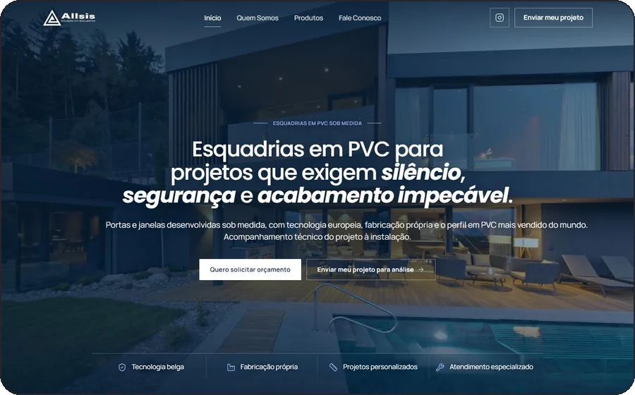</a>
<h3>Allsis Brasil</h3>
Esquadrias de PVC com tecnologia europeia para projetos de alto padrão. Foto noturna de obra, título com itálico de destaque e dois caminhos claros: pedir orçamento ou enviar o projeto para análise.
  

</td>
<td width="50%" valign="top">
<a href="https://esquadriasefachadas.com.br">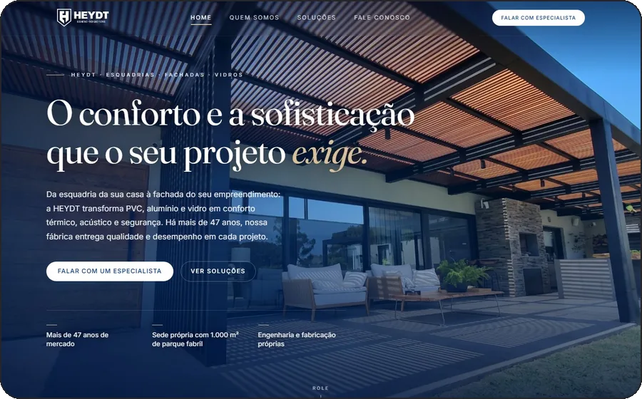</a>
<h3>Heydt Esquadrias</h3>
Esquadrias, fachadas e vidros de alto padrão, há 47 anos em Maravilha (SC). Uma empresa com história que precisava de uma porta de entrada à altura.
  

</td>
</tr>
<tr>
<td width="50%" valign="top">
<a href="https://kikoesquadrias.com.br">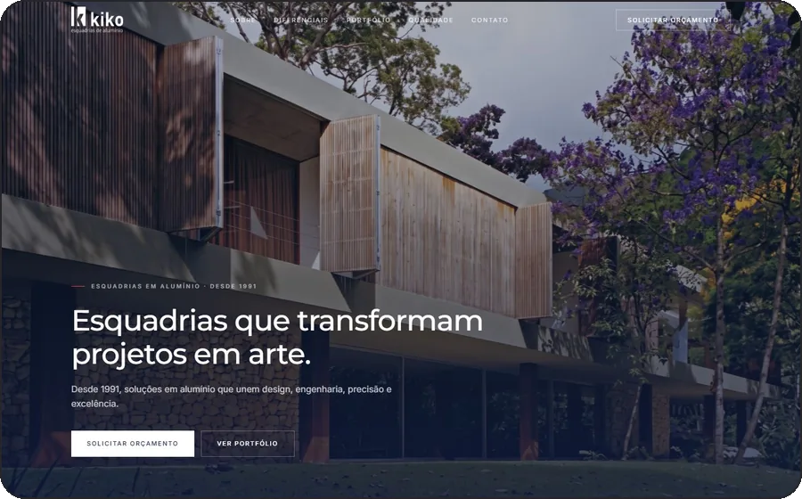</a>
<h3>Kiko Esquadrias</h3>
Esquadrias de alumínio para obras de alto padrão, desde 1991.
  

</td>
<td width="50%" valign="top">
<a href="https://lp.vidracariastilo.com.br">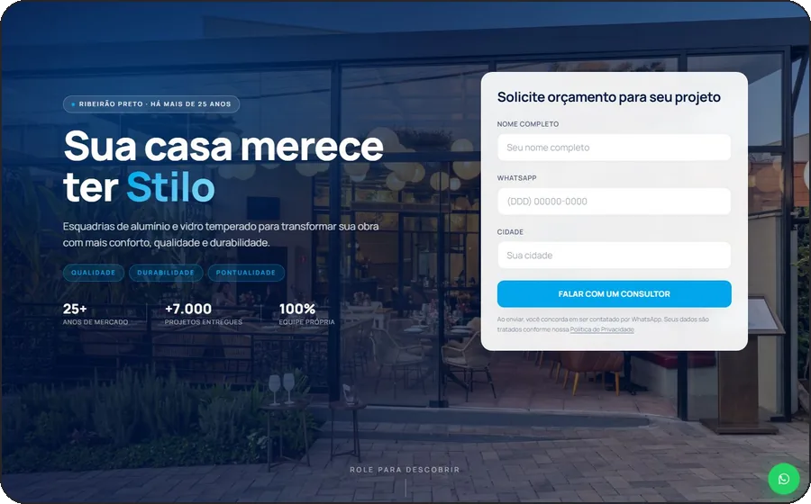</a>
<h3>Stilo Esquadrias &amp; Vidros</h3>
Alumínio e vidro temperado em Ribeirão Preto (SP), há mais de 25 anos. Formulário já na primeira dobra, números de prova social e WhatsApp sempre à mão. HTML, CSS e JavaScript puros.
  

</td>
</tr>
<tr>
<td width="50%" valign="top">
<a href="https://casabemotto.com.br">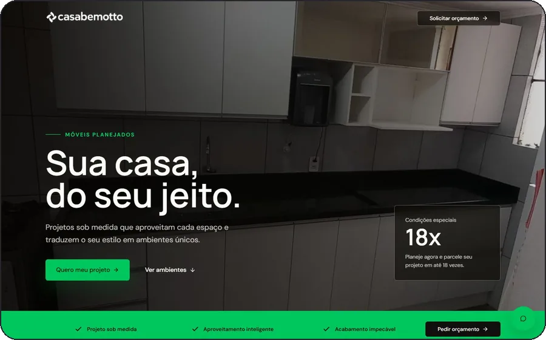</a>
<h3>Casabem Otto</h3>
Móveis planejados sob medida, com o argumento comercial na frente: projeto parcelado em até 18x.
  

</td>
<td width="50%" valign="top">
<a href="https://woltzsolar.com">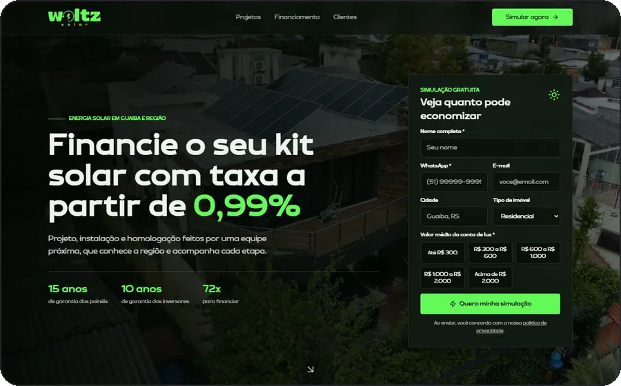</a>
<h3>Woltz Solar</h3>
Energia solar em Guaíba (RS). O visitante simula a própria economia na página e vê o financiamento a partir de 0,99%, antes mesmo de falar com alguém.
  

</td>
</tr>
</table>


<table>
<tr>
<td width="50%" valign="top">
<a href="assets/d-revista-criare-02-mockup.webp">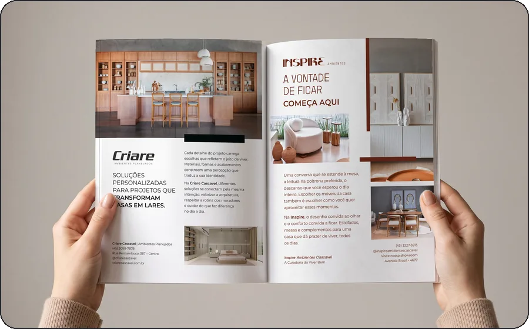</a>
<h3>Revista Criare, Edição 2</h3>
Página dupla editorial para a Criare Ambientes Planejados e a Inspire Ambientes, em Cascavel (PR): "A vontade de ficar começa aqui". Fotos sangradas, grid de revista e arquivo fechado em CMYK para a gráfica.
</td>
<td width="50%" valign="top">
<a href="assets/d-revista-criare-01-mockup.webp">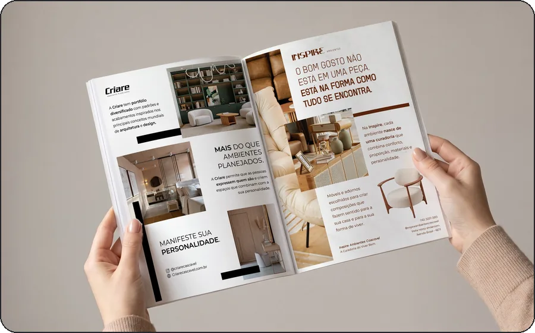</a>
<h3>Revista Criare, Edição 1</h3>
A primeira página dupla da série: "Mais do que ambientes planejados". Duas marcas, cada uma com a sua paleta e tipografia, dividindo o mesmo espaço.
</td>
</tr>
<tr>
<td width="50%" valign="top">
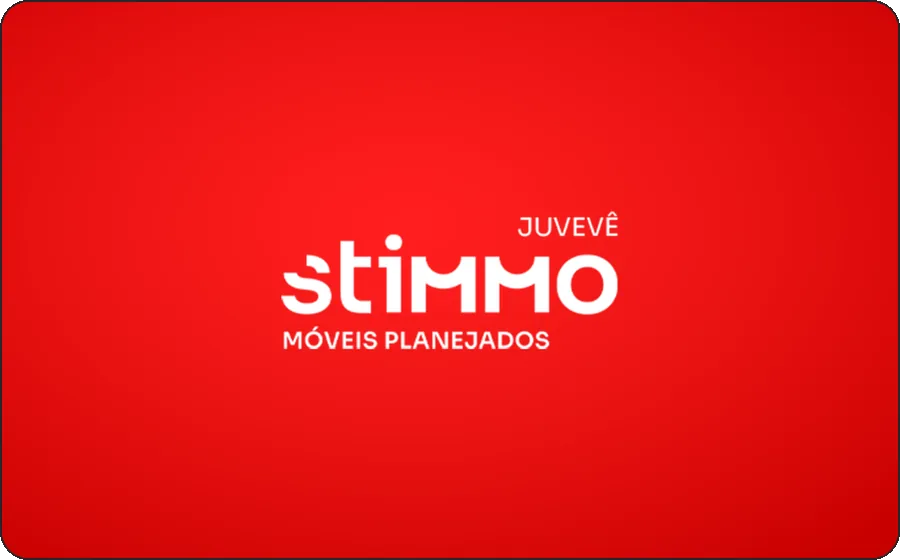
<h3>Stimmo Juvevê</h3>
Carrosséis e posts para móveis planejados em Curitiba (PR), sempre com o vermelho da marca puxando o olhar.
</td>
<td width="50%" valign="top">
<a href="https://www.behance.net/gallery/225893721/ECOSSISTEMA-BASE">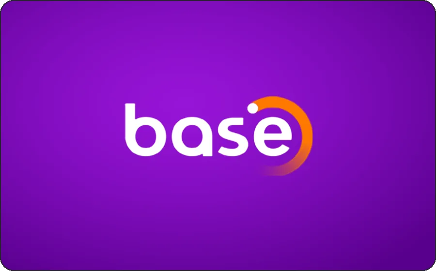</a>
<h3>Ecossistema Base</h3>
Peças gráficas para as empresas do ecossistema atendido pela Base, respeitando a identidade de cada marca.
</td>
</tr>
<tr>
<td width="50%" valign="top">
<a href="https://www.behance.net/gallery/241164185/App-Gooday">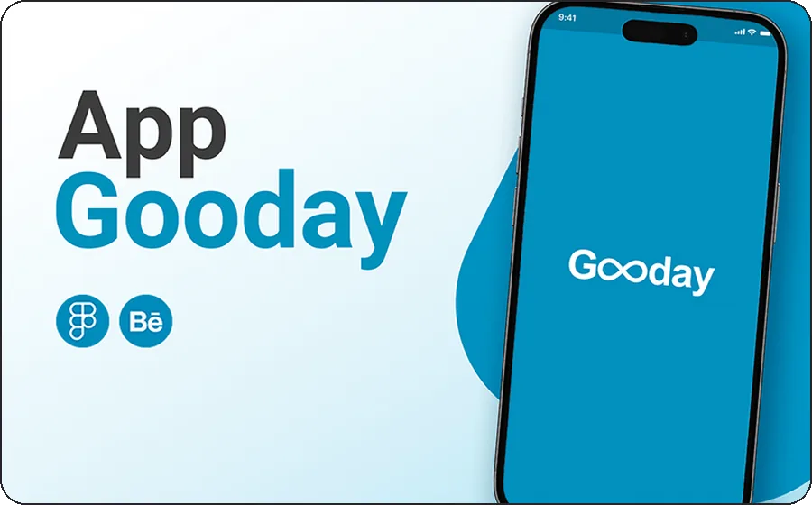</a>
<h3>App Gooday</h3>
Interface no Figma de uma rede social que reúne treinos, alimentação e bem-estar em um só aplicativo.
</td>
<td width="50%" valign="top">
<a href="https://www.behance.net/gallery/178182871/Escola-de-Gestao-do-Parana">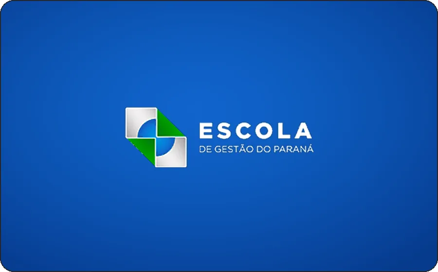</a>
<h3>Escola de Gestão do Paraná</h3>
Posts para o Instagram da escola de governo do Paraná, divulgando cursos e eventos.
</td>
</tr>
<tr>
<td width="50%" valign="top">
<a href="https://www.behance.net/gallery/223863701/Pelos-Teatros-de-Joao-Pessoa">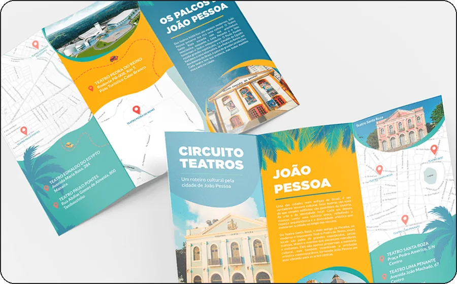</a>
<h3>Pelos Teatros de João Pessoa</h3>
Folder com mapa e roteiro pelos teatros de João Pessoa (PB).
</td>
<td width="50%" valign="top">
<h3>Nos bastidores</h3>
Além das peças, automatizo o meu próprio fluxo: scripts que montam PSDs com pranchetas no Photoshop, pipeline de vídeo com ffmpeg para Reels com legenda e trilha, e motion escrito em HTML para anúncios e tours de render.
  

</td>
</tr>
</table>


  

  
  
  

 

<a href="https://www.behance.net/Gustav_w">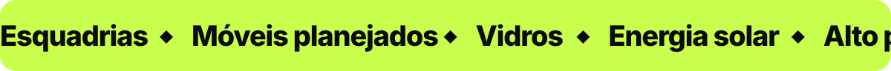</a>
